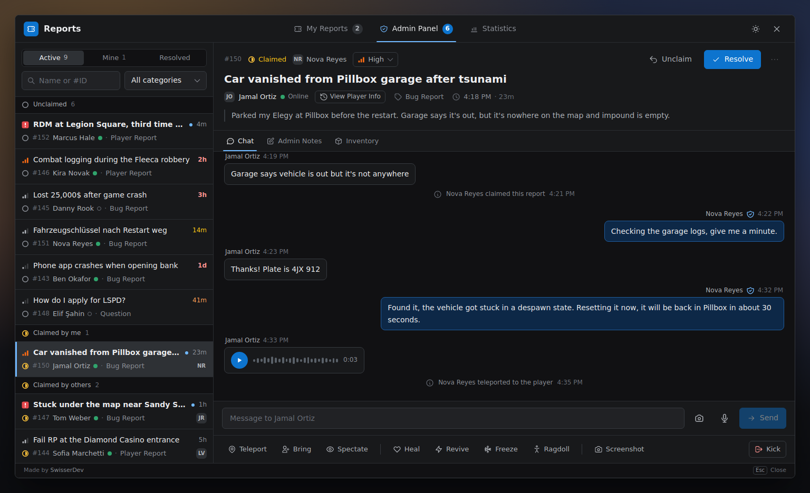
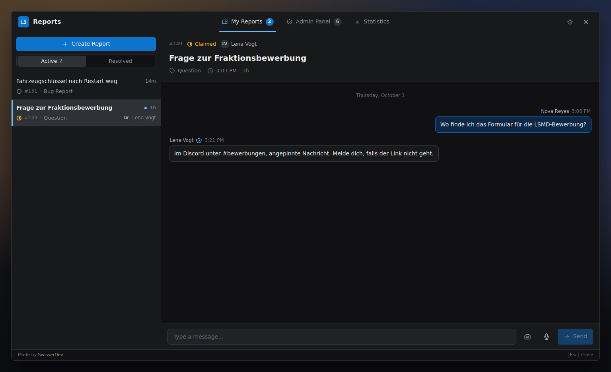
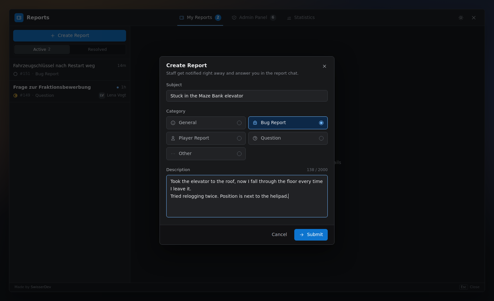
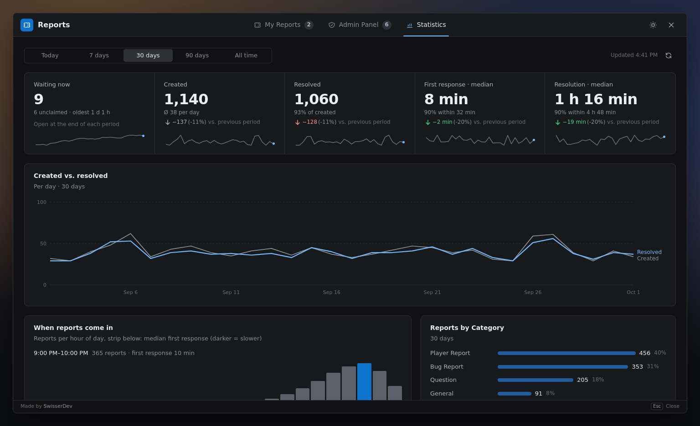
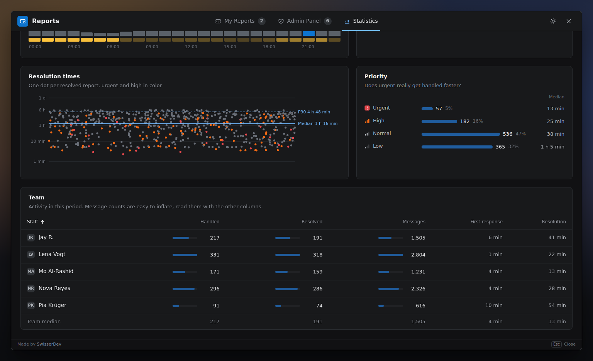
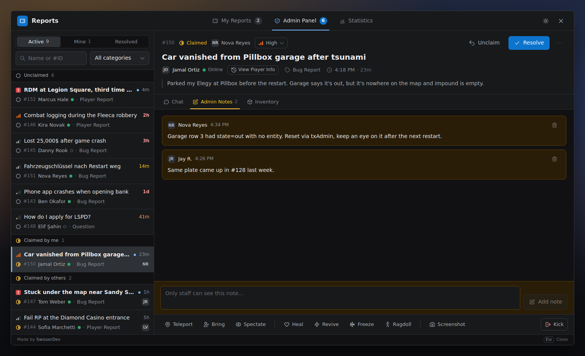
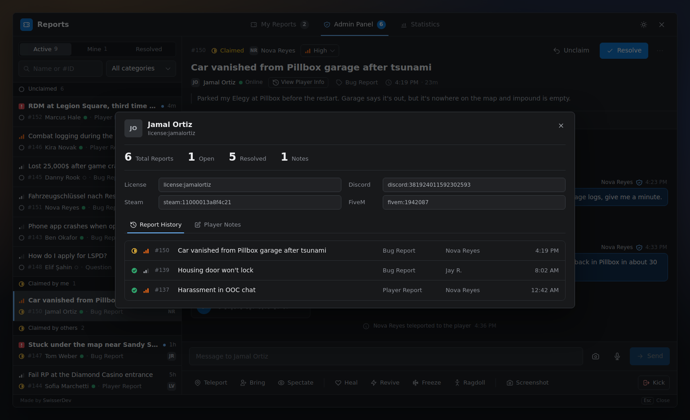
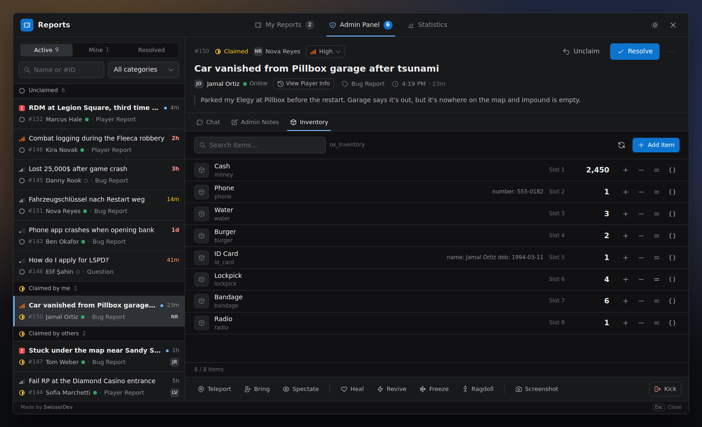
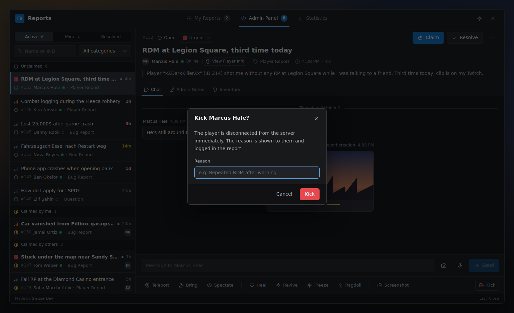
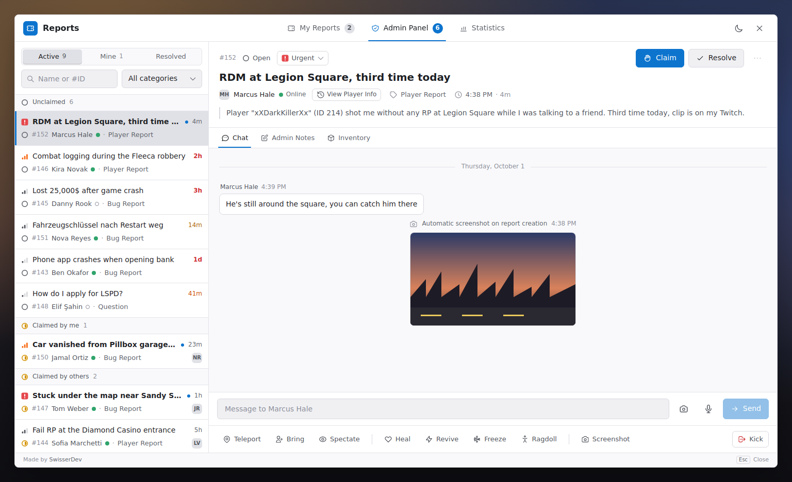

<div align="center">

# SWS Report

[](https://github.com/SwisserDev/sws-report/actions/workflows/build.yml)
[](LICENSE)
[](https://github.com/SwisserDev/sws-report/releases)
[](#requirements)

In-game report and support system for FiveM. Players open a report, staff pick it up from a queue, talk to the player in a live chat and act on them without leaving the menu. No framework required.



</div>

---

## What you get

**For players**
- `/report` opens a menu to file a report with subject, category and description
- Live chat with staff, screenshots and optional voice messages
- Their own report history, active and resolved

**For staff**
- A queue grouped into *unclaimed*, *claimed by me* and *claimed by others*, most urgent and oldest first
- Waiting time that turns amber, orange and red the longer nobody picks a report up, plus a marker when the player is waiting for an answer
- Claim, resolve, set priority and delete right next to the report title
- Teleport, bring, spectate, heal, revive, freeze, ragdoll, screenshot and kick from a toolbar under the chat; kick and delete ask for confirmation, kicks take a reason
- Staff-only notes per report and per player, report history and identifiers of every player
- Inventory view and editing for ox_inventory and ESX
- Statistics with median first response and resolution times, backlog, busiest hours and a per-staff table

**For server owners**
- Works with ESX, QBCore, Qbox or no framework at all
- ACE permissions or fine-grained permission groups with inheritance
- Discord logging for every action, screenshots and voice messages through the same webhook
- English, German, French and Japanese included, more is a single Lua file
- Dark and light theme, scales with the game resolution from 720p to 4K
- Tested in Chromium 103, the browser FiveM ships (CEF 103)

---

## Screenshots

<table>
  <tr>
    <td width="50%"><br><sub>Player view: own reports and the chat with staff</sub></td>
    <td width="50%"><br><sub>Creating a report</sub></td>
  </tr>
  <tr>
    <td><br><sub>Statistics: KPIs with comparison to the previous period</sub></td>
    <td><br><sub>Resolution times, priorities and the team table</sub></td>
  </tr>
  <tr>
    <td><br><sub>Staff notes, never visible to the player</sub></td>
    <td><br><sub>Player history, identifiers and player notes</sub></td>
  </tr>
  <tr>
    <td><br><sub>Inventory management</sub></td>
    <td><br><sub>Kick with a reason that is shown to the player and logged</sub></td>
  </tr>
  <tr>
    <td><br><sub>Light theme</sub></td>
    <td></td>
  </tr>
</table>

---

## Requirements

- [oxmysql](https://github.com/overextended/oxmysql)
- MySQL or MariaDB
- Optional: [screenshot-basic](https://github.com/citizenfx/screenshot-basic) or [screencapture](https://github.com/itschip/screencapture) for screenshots
- Optional: a Discord webhook for logging, screenshots and voice messages
- Optional: ox_inventory or ESX for inventory management

---

## Installation

1. Download `sws-report-vX.Y.Z.zip` from [Releases](https://github.com/SwisserDev/sws-report/releases). It contains the built UI.
   The green *Code → Download ZIP* button on GitHub does **not**, the menu would open without anything visible.
2. Extract it to `resources/sws-report`.
3. Import `sql/install.sql` into your database (HeidiSQL, phpMyAdmin or `mysql -u root -p your_db < sql/install.sql`).
4. Add to `server.cfg`:
   ```cfg
   ensure oxmysql
   ensure sws-report
   ```
5. Give your staff access, see [Permissions](#permissions).

Updating from an older version: [UPGRADING.md](UPGRADING.md).

---

## Configuration

Everything lives in `config/main.lua`. The settings you will most likely touch:

```lua
Config.Locale = "en"              -- en, de, fr, ja
Config.Command = "report"         -- chat command, also bindable under Settings > Key Bindings
Config.Cooldown = 60              -- seconds between two reports of the same player
Config.MaxActiveReports = 3       -- open reports per player

Config.AdminAcePermission = "report.admin"
Config.AdminIdentifiers = {}      -- e.g. { "license:abc123...", "discord:1234..." }

Config.Discord = {
    enabled = true,
    webhook = "https://discord.com/api/webhooks/...",
    events = { chatMessage = false }   -- every event can be switched off on its own
}

Config.Screenshot = {
    provider = "screenshot-basic",  -- or "screencapture"
    autoOnCreate = false            -- take a screenshot when a report is created
}

Config.VoiceMessages = { enabled = true, maxDurationSeconds = 60 }

Config.UI = {
    defaultTheme = "dark",
    scale = 1.0                     -- on top of the automatic resolution scaling
}

-- Use your framework's notifications instead of the GTA feed
Config.CustomNotify = function(source, message, type)
    TriggerClientEvent("ox_lib:notify", source, { description = message, type = type })
end
```

Categories, priorities, sounds and inventory limits are in the same file with comments.

---

## Permissions

Access is granted through FiveM's ACE system. The resource only *checks* ACEs, you define them in `server.cfg` above `ensure sws-report`.
Permissions are re-checked every time the menu opens, so groups your framework assigns after character selection work without reconnecting.

### Simple: everyone with access is a full admin

Leave `Config.Permissions` commented out.

```cfg
add_ace group.admin report.admin allow
add_principal identifier.license:abc123... group.admin
```

Listing identifiers in `Config.AdminIdentifiers` works as well and needs no ACE at all.

### Permission groups

Uncomment `Config.Permissions` in the config. The default setup maps three ACEs to groups, each inheriting the one before:

| ACE                 | Group        | Can do                                                        |
|---------------------|--------------|---------------------------------------------------------------|
| `report.moderator`  | `moderator`  | view, claim, resolve, priority, chat, notes, teleport, bring, heal, revive, spectate, screenshot, player history |
| `report.admin`      | `admin`      | moderator + delete, freeze, ragdoll, kick, inventory, statistics |
| `report.superadmin` | `superadmin` | everything                                                     |

```cfg
add_ace group.moderator  report.moderator  allow
add_ace group.admin      report.admin      allow
add_ace group.superadmin report.superadmin allow

add_principal identifier.license:abc123... group.moderator
```

A player with several matching ACEs gets the group with the most permissions. `identifierGroups` in the config pins a single person to a group without touching `server.cfg`.

All permission names: `view_reports`, `claim_report`, `resolve_report`, `delete_report`, `set_priority`, `send_admin_message`, `view_notes`, `manage_notes`, `teleport_to`, `bring_player`, `heal_player`, `revive_player`, `freeze_player`, `spectate_player`, `screenshot_player`, `ragdoll_player`, `kick_player`, `manage_inventory`, `view_statistics`, `view_player_history`.

---

## Statistics

Pick *Today*, *7 days*, *30 days*, *90 days* or *All time*. Every number is compared with the same elapsed time one period earlier (today until now vs. yesterday until the same time).

| Number | Meaning |
|--------|---------|
| Waiting now | Open plus claimed reports right now, with the age of the oldest one |
| Created / Resolved | Reports created and resolved in the period |
| First response | Time from creating a report to the first chat message from staff. Median, plus the time 90% of reports were answered within |
| Resolution | Time from creating a report to resolving it, median and 90th percentile |

Medians instead of averages, because one report that sat open over night would otherwise drown out a hundred quick ones. Durations based on fewer than five reports are shown greyed out.

Below that: created vs. resolved over time, reports per hour of day with the response time per hour, categories, priorities with their resolution time, one dot per resolved report, and a table per staff member. The table is sorted by name on purpose, there is no ranking.

---

## Commands, exports and events

| Command | |
|---------|-|
| `/report` | Open or close the menu (name set by `Config.Command`) |

**Server exports**
```lua
exports["sws-report"]:IsAdmin(source)
exports["sws-report"]:HasPermission(source, "kick_player")
exports["sws-report"]:GetPlayerGroup(source)
exports["sws-report"]:GetOnlineAdmins()
exports["sws-report"]:GetReports({ status = "open" })   -- active reports, optional filter by status/playerId
exports["sws-report"]:GetReport(reportId)
exports["sws-report"]:CloseReport(reportId)              -- resolves the report and updates every open menu
exports["sws-report"]:GetPlayerHistory(identifier)
exports["sws-report"]:GetReportNotes(reportId)
exports["sws-report"]:GetPlayerNotes(identifier)
exports["sws-report"]:IsInventoryAvailable()
exports["sws-report"]:GetInventorySystemName()
```

**Client exports**
```lua
exports["sws-report"]:OpenUI()
exports["sws-report"]:CloseUI()
exports["sws-report"]:ToggleUI()
exports["sws-report"]:IsUIOpen()
```

**Server events** (`AddEventHandler`, not networked)
```lua
AddEventHandler("sws-report:onCreated", function(report) end)
AddEventHandler("sws-report:onClaimed", function(report, adminIdentifier) end)
AddEventHandler("sws-report:onResolved", function(report, adminIdentifier) end) -- nil when closed via CloseReport
AddEventHandler("sws-report:onDeleted", function(report, deletedByIdentifier) end)
```

If you renamed the resource folder, use that name instead of `sws-report` in the exports.

---

## Troubleshooting

**The menu opens (cursor appears) but nothing is visible.**
The UI build is missing. The server console prints `UI build missing (web/out/index.html)` on start. Use the release zip or build the UI yourself (see below).

**Staff don't see the Admin Panel tab.**
Their ACE isn't set or doesn't match `Config.AdminAcePermission` / `aceGroups`. Set `Config.Debug = true` and check the console when they open the menu.

**Reports can't be created, statistics stay empty.**
`sql/install.sql` wasn't imported.

**Old screenshots or voice messages don't load anymore.**
They are stored on Discord's CDN. Discord signs attachment links and lets them expire after about a day when they are opened outside Discord. The originals stay in your Discord channel.

---

## Building the UI yourself

Only needed if you change the interface. Requires Node.js 20+.

```bash
cd web
npm ci
npm run dev     # browser preview at http://localhost:3000 with demo data
npm run build   # writes web/out, which FiveM loads
```

The browser preview fakes the Lua side, so every button works. Useful URL parameters: `?tab=admin&report=150`, `?tab=statistics`, `?theme=light`, `?lang=de`, `?scale=1.2`. Details and the CEF 103 rules for contributors are in [web/README.md](web/README.md).

---

## Documentation

| Document | |
|----------|-|
| [UPGRADING.md](UPGRADING.md) | Updating, database migrations |
| [INVENTORY.md](INVENTORY.md) | Inventory management and custom inventory adapters |
| [CHANGELOG.md](CHANGELOG.md) | What changed in each version |
| [web/README.md](web/README.md) | Working on the UI |

---

## License

[MIT](LICENSE)

<div align="center">
  <sub>Made by <a href="https://swisser.dev">SwisserDev</a></sub>
  <br><br>
  <a href="https://metrics.swisser.dev">Metrics</a> &bull;
  <a href="https://win.swisser.dev">Win</a> &bull;
  <a href="https://swisser.cloud">Cloud</a>
</div>
